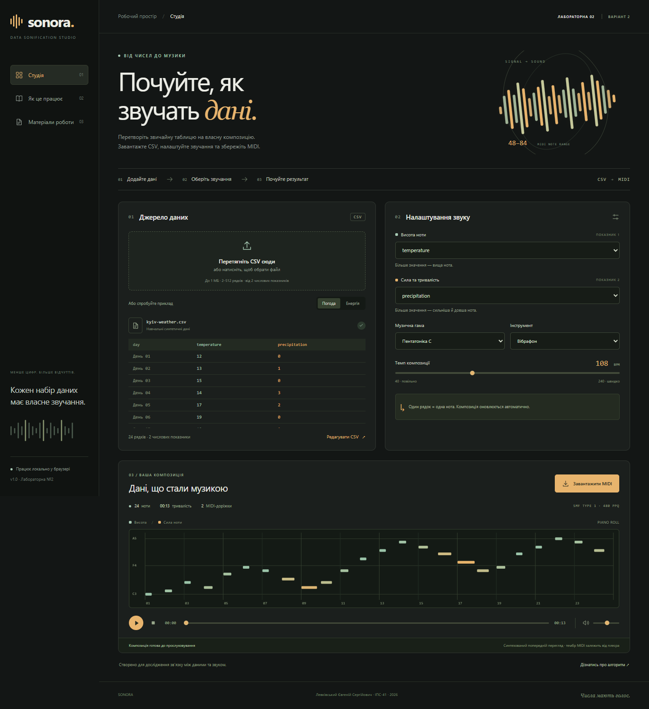

# SONORA — соніфікація даних у MIDI

**Лабораторна робота №2 · Варіант 2**  
Левківський Євгеній Сергійович · **ІПС-41**

Мультимедійний застосунок перетворює два числові показники з CSV на MIDI-композицію: перший задає висоту ноти, другий — velocity та тривалість. Композиція формується автоматично після завантаження даних або зміни налаштувань.

**[Відкрити застосунок](https://fffooocus.github.io/sonora-lab2/)** · **[Звіт PDF](docs/report.pdf)** · **[Звіт DOCX](docs/report.docx)** · **[Сценарій захисту](docs/DEFENSE.md)**



## Запуск за хвилину

Потрібен **Node.js 22+**. Для роботи застосунку немає npm-залежностей.

```sh
npm start
```

Відкрити **http://127.0.0.1:4173**. У Windows можна двічі натиснути **Запустити SONORA.cmd**. Для зупинки сервера — Ctrl+C у його вікні. Не відкривайте `index.html` через `file://`: ES-модулі та завантаження прикладів потребують HTTP.

Онлайн-версія працює без установлення. Усі дані обробляються у браузері, без надсилання CSV на сервер. Після завантаження сторінки можна імпортувати власні файли без мережі; перезавантаження сайту та відкриття прикладів онлайн потребують доступу до хостингу. Для повністю автономного запуску використовуйте локальний сервер.

## Як користуватись

1. Відкрийте готовий приклад «Погода» або «Енергія», імпортуйте CSV чи вставте дані через «Редагувати CSV».
2. Оберіть два різні числові стовпці: для висоти та для сили/тривалості ноти.
3. Задайте гаму, MIDI-інструмент і темп. Результат оновлюється автоматично.
4. Прослухайте композицію, використовуючи Play/Pause, Stop, позицію та гучність. Пробіл — Play/Pause, Esc — Stop, коли фокус поза елементами введення.
5. Натисніть «Завантажити MIDI». Файл можна імпортувати в DAW або MIDI-плеєр зі звуковим банком.

## Відповідність завданню

| Обов’язкова вимога | Реалізація |
| --- | --- |
| Щонайменше два числові показники | CSV перевіряється; обираються два різні числові стовпці |
| Кожен показник впливає на MIDI | Показник 1 → pitch; показник 2 → velocity і duration |
| Автоматично сформований MIDI-файл | Власний SMF Type 1 encoder, дві доріжки, 480 PPQ |
| Пояснення правил у звіті | Формули, розрахунок, архітектура та обмеження у PDF/DOCX |
| Якість реалізації | Окремі модулі CSV, нормалізації, MIDI, аудіо; автоматизовані перевірки |
| Додаткові можливості | Піанороль, Web Audio, редактор CSV, 4 гами, 4 інструменти, адаптивний UI |

## Формат CSV

```csv
label,temperature,precipitation
Day A,12,0
Day B,18,5
Day C,24,10
```

Заголовки унікальні й непорожні; 2–512 рядків, до 32 стовпців та 1 МБ. Принаймні два стовпці повністю числові, без пропусків, NaN та Infinity. Підтримуються UTF-8/BOM, CRLF, лапки, кома, `;`, табуляція. Для десяткової коми потрібен `;` або табуляція. Неправильний файл не замінює попередній набір. Формули у клітинках не виконуються.

У `examples/` є три **синтетичні навчальні** набори та готовий `sonora-weather.mid`. Вони не є реальними метеорологічними або енергетичними вимірюваннями. Якщо часові мітки числові, вони теж доступні як показник: самостійно оберіть потрібні два стовпці.

## Правила перетворення

Окрема min–max нормалізація: `u = (x − min) / (max − min)`; для констант `u = 0.5`. Перший показник вибирає `round(u × (N − 1))`-й елемент музичної гами. Другий задає `velocity = round(40 + 75v)` та `duration = round(480 × (0.35 + 0.55v))` ticks. Нота починається на `rowIndex × 480`; загальна тривалість — `rows × 60 / BPM`.

MIDI: Type 1, 480 PPQ, розмір 4/4. Перша доріжка — темп та метадані, друга — одноголосна мелодія з Program Change, Note On, Note Off. Часові проміжки у CSV не інтерпретуються: один рядок займає одну чверть. Регулятор гучності впливає лише на прослуховування; MIDI velocity визначає другий показник. Попередній перегляд — простий осциляторний синтез; точний тембр General MIDI залежить від зовнішнього плеєра.

## Перевірки та збирання

```sh
npm ci
npm test
npm run test:browser
npm run docs
npm run build
npm run release
```

На Linux/macOS перед браузерною перевіркою встановіть Chromium: `npx playwright install chromium` (у CI — з `--with-deps`). У Windows використовується встановлений Edge/Chrome; можна задати `BROWSER_PATH`.

Модульні тести перевіряють імпорт, нормалізацію, обидва показники, VLQ, парні Note On/Off та дві доріжки через незалежний парсер `midi-file`. Playwright перевіряє користувацькі сценарії, реальне завантаження `.mid`, Web Audio та адаптивність 390/768/1440 px. Результати — [verification.json](docs/verification.json). Автоматичні тести не підтверджують суб’єктивну якість тембру; імпорт у зовнішню DAW слід показати окремо за наявності.

`npm run docs` формує HTML/PDF/DOCX з [REPORT.md](docs/REPORT.md), додаючи скриншоти та результати перевірок. `npm run build` створює `dist/` і готовий MIDI. `npm run release` пакує проєкт зі звітом у `artifacts/SONORA-lab2-IPS41.zip`. Для коректного комплекту виконуйте команди у наведеному порядку.

## Структура

```text
web/
  index.html, styles.css, app.js   інтерфейс та взаємодія
  lib/csv.js                     читання та перевірка CSV
  lib/sonify.js                  нормалізація і відображення у ноти
  lib/midi.js                    власний запис Standard MIDI File
  lib/audio.js                   планування синтезу Web Audio
examples/                        CSV та згенерований MIDI
tests/                           модульні перевірки
scripts/                         сервер, build, QA, звіт та ZIP
docs/                            звіт, захист, скриншоти, протокол
docs/pages-workflow.yml.example   додатковий шаблон CI
```

GitHub Pages публікує готовий сайт із гілки `gh-pages`. Команда `npm run publish:pages` завантажує актуальний `dist/` у цю гілку та налаштовує Pages через GitHub CLI; потрібен `gh auth login` і доступ на запис до репозиторію. Перед публікацією виконайте перевірки, формування звіту та build. Секрети в коді й бекенд не потрібні. Додатковий шаблон CI збережено у `docs/pages-workflow.yml.example`; він не є активним workflow. Його можна активувати за наявності GitHub-доступу зі scope `workflow`.

## Першоджерела

- [MIDI Association — Standard MIDI Files](https://midi.org/standard-midi-files)
- [MDN — Web Audio API](https://developer.mozilla.org/en-US/docs/Web/API/Web_Audio_API)
- [MDN — File API](https://developer.mozilla.org/en-US/docs/Web/API/File_API)
- [midi-file — незалежний MIDI-парсер](https://github.com/carter-thaxton/midi-file)
- [Playwright — перевірки браузера](https://playwright.dev/docs/intro)
- [GitHub Docs — GitHub Pages](https://docs.github.com/en/pages/getting-started-with-github-pages/creating-a-github-pages-site)
