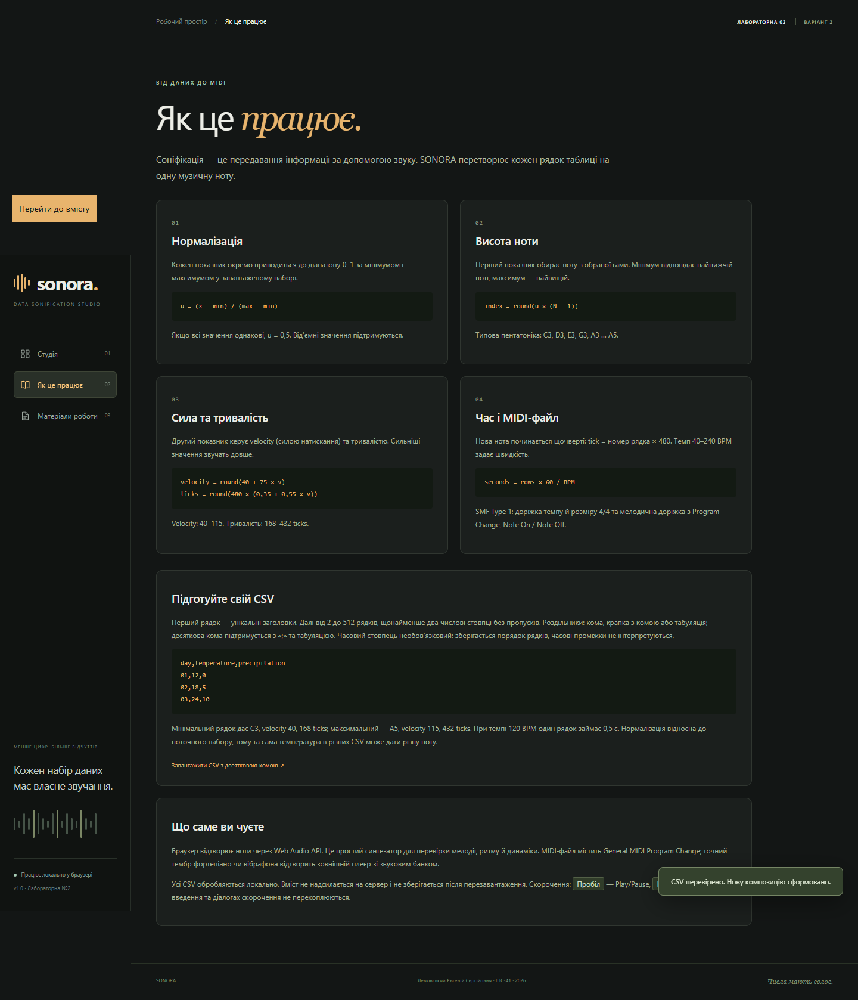

## 1. Мета роботи

Розробити мультимедійний застосунок із використанням сучасних вебтехнологій, що перетворює числові дані на MIDI-композицію. Реалізувати правила впливу принаймні двох числових показників на параметри MIDI, автоматичне формування файлу та засоби демонстрації результату.

Обрано варіант 2 — «Соніфікація даних». Назва застосунку — SONORA. Мова програмування — JavaScript, інтерфейс — HTML5 та CSS3, синтез звуку — Web Audio API. Застосунок працює у браузері, що дозволено умовами цього варіанта; вимога desktop стосується варіанта 1.

## 2. Постановка задачі та відповідність вимогам

| Вимога | Реалізація у SONORA |
| --- | --- |
| Вхідні дані містять щонайменше два числові показники | Імпорт CSV, перевірка числових стовпців, вибір двох різних показників |
| Кожен показник впливає хоча б на один параметр MIDI | Перший → висота; другий → velocity і тривалість |
| Автоматичне формування MIDI-файлу | Після імпорту та змін налаштувань створюється модель композиції; завантажується готовий SMF Type 1 |
| Пояснення перетворення у звіті | Нормалізація, формули, гами та приклад обчислення в розділі 5 |
| Якість і структура коду | Розділення CSV, соніфікації, запису MIDI, звуку та UI; автоматизовані перевірки |
| Додаткові можливості | Піанороль, програвання, редагування CSV, вибір темпу, гами та інструмента, адаптивність |

Пункти охоплюють функціональну частину завдання та додаткові можливості. Остаточну оцінку визначає викладач.

## 3. Обрані технології та архітектура

Браузерний застосунок використовує ES-модулі без фреймворків та сторонніх runtime-бібліотек. Власні CSV-парсер і MIDI-кодувальник дають можливість явно показати алгоритми перевірки та перетворення. Для локального HTTP-сервера й допоміжних команд потрібен Node.js 22+.

Потік обробки: CSV → перевірена таблиця → нормалізація двох показників → список нот → синтез і візуалізація → MIDI-файл. Інтерфейс не виконує формули з клітинок; імпортовані назви виводяться через textContent. Дані не надсилаються на сервер і зберігаються лише в оперативній пам’яті поточної сторінки.

| Модуль | Відповідальність |
| --- | --- |
| web/lib/csv.js | Визначення роздільника, читання лапок, перевірка таблиці й числових стовпців |
| web/lib/sonify.js | Нормалізація, вибір гами, обчислення pitch, velocity, duration і часу |
| web/lib/midi.js | Заголовок SMF, VLQ, метаподії, дві доріжки та запис байтів |
| web/lib/audio.js | Web Audio, планування нот, Play/Pause, Stop, позиція та гучність |
| web/app.js | Події інтерфейсу, імпорт, піанороль, навігація та скачування |
| scripts/ | Локальний сервер, збирання, перевірки, формування звітів і архіву |

Додаткові npm-пакети використовуються для розробки: midi-file — незалежне читання експорту в тестах; Playwright — браузерна перевірка й друк PDF; docx — оформлення документа Word. Вони не завантажуються користувачем сайту.

## 4. Вхідні дані та перевірка

Перший рядок CSV містить унікальні непорожні заголовки. Далі допускається від 2 до 512 рядків, до 32 стовпців і 1 МБ тексту. Повністю числовими вважаються стовпці, де кожне значення є скінченним числом. Підтримуються від’ємні числа, дробові числа та науковий запис. NaN, Infinity, порожні клітинки і суфікси на зразок 12abc не є числами.

Роздільник визначається за заголовком поза лапками: кома, крапка з комою або табуляція. Підтримуються UTF-8 BOM, CRLF, коми та переноси рядків усередині подвійних лапок, екранування лапок через їх подвоєння. Для десяткової коми потрібен роздільник «;» або табуляція. Некоректний імпорт показує повідомлення й залишає попередній робочий набір.

Готові набори kyiv-weather.csv та energy.csv є синтетичними навчальними прикладами, а не фактичними вимірюваннями. Перший містить 24 рядки з temperature та precipitation, другий — 16 рядків з consumption та solar. Додатковий semicolon.csv демонструє українські заголовки й десяткову кому. Текстові day/hour збережено як підписи; порядок рядків визначає порядок нот.

## 5. Правила перетворення даних у звук

### 5.1. Нормалізація

Кожен із двох показників нормалізується окремо за мінімальним і максимальним значеннями в поточному наборі. Для першого показника результат позначено u, для другого — v.

```
u = (x − xmin) / (xmax − xmin)
v = (y − ymin) / (ymax − ymin)
```

Значення належать діапазону [0; 1]. Якщо максимум дорівнює мінімуму, використовується 0,5, щоб уникнути ділення на нуль. Реалізація попередньо масштабує числа за їх найбільшим модулем, щоб різниця дуже великих скінченних значень не переповнювала числовий тип. Нормалізація є відносною: однакове вихідне число може відповідати різним нотам у різних наборах.

### 5.2. Перший показник → висота ноти

Нормалізоване u вибирає індекс у впорядкованому масиві нот обраної гами. Для N нот індекс обчислюється як round(u × (N − 1)). Типова пентатоніка до мажору містить 15 нот:

```
[48, 50, 52, 55, 57, 60, 62, 64,
 67, 69, 72, 74, 76, 79, 81]
```

Нумерація використовує MIDI middle C = 60 (C4). Отже, мінімальне значення дає C3 (48), максимальне — A5 (81). Доступні також до мажор, ля мінор і хроматична гама. Квантування до гами забезпечує передбачувану музичну структуру, хоча близькі числа можуть потрапити в одну ноту.

### 5.3. Другий показник → velocity і тривалість

```
velocity = round(40 + 75 × v)
durationTicks = round(480 × (0,35 + 0,55 × v))
```

Сила натискання змінюється від 40 до 115, що входить у діапазон звучної MIDI Note On. Тривалість — від 168 до 432 ticks, тобто 0,35–0,90 чверті. Більше значення другого показника утворює сильнішу й довшу ноту. Оскільки тривалість менша за крок 480 ticks, ноти не перекриваються, зокрема при повторенні висоти.

### 5.4. Часова сітка та інструмент

Один рядок відповідає одній чверті. Початок ноти i, де i рахується від нуля: startTick = i × 480. Note Off записується на startTick + durationTicks. Для R рядків та темпу B тривалість композиції становить R × 60 / B секунд, включно з паузою наприкінці останньої чверті. Реальні проміжки між часовими мітками CSV не обчислюються.

Темп налаштовується від 40 до 240 BPM. Інструмент задає MIDI Program Change: 0 — Acoustic Grand Piano, 10 — Music Box, 11 — Vibraphone, 80 — Lead 1 (square). Це нумерація від нуля, яка записується у файл; у деяких редакторах інструменти відображаються від 1.

### 5.5. Контрольний приклад

Вхідна таблиця: x = [0; 5; 10], y = [0; 5; 10]. Пентатоніка C, темп 120 BPM. Для обох стовпців нормалізовані значення — [0; 0,5; 1].

| Рядок | u / v | MIDI note | Velocity | Duration, ticks | Початок, ticks |
| --- | --- | --- | --- | --- | --- |
| 1 | 0 / 0 | 48, C3 | 40 | 168 | 0 |
| 2 | 0,5 / 0,5 | 64, E4 | 78 | 300 | 480 |
| 3 | 1 / 1 | 81, A5 | 115 | 432 | 960 |

Загальна тривалість — 3 × 60 / 120 = 1,5 с. Друга нота звучить 300 / 480 × 0,5 = 0,3125 с. Ці значення перевіряються автоматизованим тестом; окремий незалежний MIDI-парсер перевіряє їх після серіалізації у файл.

## 6. Формування Standard MIDI File

Використано SMF Type 1 із двома синхронними доріжками та роздільною здатністю 480 PPQ. Заголовок MThd містить довжину 6, формат 1, кількість доріжок 2 та division = 480. Кожен блок MTrk має довжину даних у байтах.

Доріжка 1 містить назву, Set Tempo (мікросекунди на чверть, round(60 000 000 / BPM)), Time Signature 4/4 і End of Track. Доріжка 2 містить назву, Program Change на MIDI-каналі 1 (індекс 0), пари Note On/Note Off та End of Track. Друга доріжка є одноголосною мелодією; дві доріжки не означають два одночасні музичні голоси.

Події сортуються за абсолютним tick. До файлу записується різниця між tick поточної та попередньої події — delta time у форматі VLQ. Назви MIDI-доріжок записано ASCII, числові поля заголовків — у big-endian. Завантаження виконується через Blob з MIME audio/midi та тимчасове object URL, яке після використання звільняється.

## 7. Інтерфейс і відтворення

Інтерфейс складається з трьох кроків: джерело даних, налаштування та результат. Таблиця показує вхідні значення, а колір виділяє показники, що відповідають pitch та expression. На піаноролі вертикальна координата відображає висоту, довжина прямокутника — тривалість, колір — другий показник. Під час відтворення рухається курсор.

Web Audio API генерує осцилятори з частотою f = 440 × 2^((note − 69) / 12). Амплітуда залежить від velocity; коротка огинаюча зменшує клацання. Планувальник працює з невеликим випередженням на основі AudioContext.currentTime. Підтримуються Pause з продовженням, Stop, переміщення та локальна гучність. Зміна даних або параметрів зупиняє попередню композицію.

Звук у браузері є попереднім синтезованим переглядом. Точний тембр General MIDI визначається звуковим банком зовнішнього плеєра. Керування гучністю не змінює velocity експортованих нот. При переході на іншу вкладку програвання призупиняється, щоб фонове обмеження таймерів не порушувало ритм.




## 8. Перевірка коректності

Модульні перевірки запускаються командою npm test. Вони охоплюють CSV з лапками, BOM, різними роздільниками, від’ємними та константними даними; помилкові рядки, NaN, переповнення, обмеження розміру; вплив обох показників; гами й інструменти; VLQ; структуру та часові події MIDI. Дані експорту читаються стороннім midi-file, а не тим самим власним кодувальником, що зменшує ризик перевірки алгоритму ним самим.

Браузерна перевірка Playwright виконує реальний імпорт, Play/Pause/Stop, переміщення, зміну темпу та інструмента, завантаження і розбір MIDI, зміну показників, редагування CSV та помилки вводу. Також перевіряється відсутність виконання HTML із клітинок, обмеження 1 МБ, навігація, клавіатура, відсутність горизонтального переповнення на ширинах 390, 768 та 1440 px і помилок JavaScript.

Підсумок фактичної браузерної перевірки автоматично додається до сформованих PDF/DOCX з docs/verification.json. Скриншоти отримано під час цієї перевірки. Автоматичні перевірки підтверджують події та працездатність інтерфейсу; суб’єктивна якість звуку й імпорт до зовнішньої DAW автоматично не засвідчуються.

## 9. Запуск, публікація та демонстрація

Онлайн: https://fffooocus.github.io/sonora-lab2/ . Вихідний код: https://github.com/fffooocus/sonora-lab2 . Локально: встановити Node.js 22+, запустити npm start і відкрити http://127.0.0.1:4173. У Windows доступний файл «Запустити SONORA.cmd». Runtime-залежності npm не потрібні; для тестів і відтворення документів спочатку виконується npm ci.

Послідовність відтворення комплекту: npm test → npm run test:browser → npm run docs → npm run build → npm run release. Команда npm run publish:pages публікує готовий dist у гілку gh-pages, яку обслуговує GitHub Pages. Перевірки виконуються до публікації локально. Окремо додано необов’язковий шаблон GitHub Actions; він не активований, оскільки поточний GitHub-токен не має scope workflow. Обрано статичний хостинг, оскільки серверна обробка даних не потрібна.

Для захисту слід показати два числові показники, пояснити їхній вплив, прослухати результат, змінити темп і гаму, імпортувати інший CSV та завантажити MIDI. Повний сценарій і короткі відповіді наведено в docs/DEFENSE.md. Готовий examples/sonora-weather.mid дозволяє продемонструвати результат без попереднього імпорту.

## 10. Висновки

Розроблено мультимедійний застосунок SONORA для соніфікації табличних даних. Два незалежні числові показники керують трьома параметрами MIDI: висотою, силою та тривалістю ноти. Реалізовано власне формування SMF Type 1, автоматичне оновлення композиції, локальну обробку CSV, візуалізацію та звуковий попередній перегляд. Правила перетворення є явними, відтворюваними та перевіреними тестами.

Практичний результат — застосунок, вихідний код, навчальні CSV, зразок MIDI, звіт і сценарій демонстрації. Подальші розширення можуть включати декілька мелодичних голосів, абсолютні шкали показників та синтезатор зі звуковим банком.

## Використані джерела

1. MIDI Association. Standard MIDI Files. https://midi.org/standard-midi-files
2. MDN Web Docs. Web Audio API. https://developer.mozilla.org/en-US/docs/Web/API/Web_Audio_API
3. MDN Web Docs. File API. https://developer.mozilla.org/en-US/docs/Web/API/File_API
4. midi-file — MIDI parser and writer. https://github.com/carter-thaxton/midi-file
5. Playwright. Documentation. https://playwright.dev/docs/intro
6. GitHub Docs. Creating a GitHub Pages site. https://docs.github.com/en/pages/getting-started-with-github-pages/creating-a-github-pages-site
